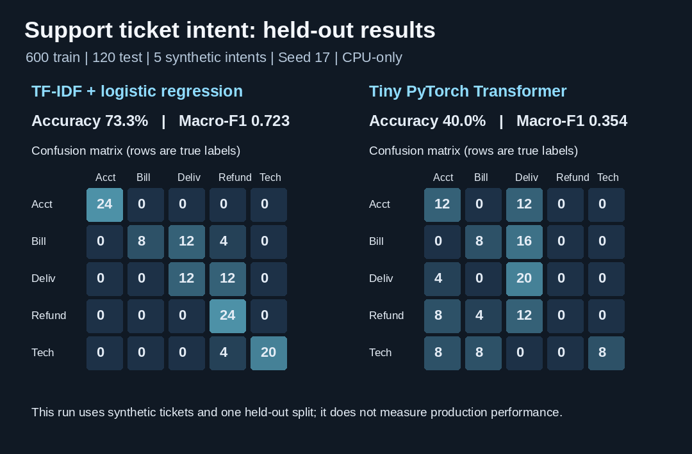

# Support Ticket Intent: TF-IDF vs. a Tiny Transformer

## Verified run output



This image was rendered from the checked-in measured JSON report. See the installation and run commands below to reproduce the experiment.

Does a neural model beat a simple baseline when you only have a few hundred short labeled messages? This experiment compares two classifiers on the same synthetic English support-ticket task: account access, billing, delivery, refunds, and technical issues.

## Reproduce the result

Tested on Linux x86-64, Python 3.12 with CPU-only PyTorch. No external dataset, API, or pretrained weights are needed.

```bash
python -m venv .venv
source .venv/bin/activate  # Windows PowerShell: .venv\Scripts\Activate.ps1
python -m pip install -r requirements.txt
python -m pip install torch==2.7.1 --index-url https://download.pytorch.org/whl/cpu
python -m unittest -v
python experiment.py --seed 17 --epochs 12 --report report.json
```

## Evaluation design

- **600 train, 120 held-out test:** five balanced classes. Each example combines a ticket template, fictional reference name, and intent-bearing action phrase. The train and test sets share no templates, names, complete action phrases, or exact example strings; task-related words may overlap.
- **Classical baseline:** word-level unigram and bigram TF-IDF plus logistic regression. Vocabulary and IDF are fitted on training text only.
- **Deep-learning comparison:** 12,229-parameter PyTorch Transformer encoder (one layer, four heads, 32-dimensional embeddings, padding-aware mean pooling), trained from scratch on one CPU thread for 12 epochs. Vocabulary comes from training text only, so unseen words all map to one unknown token.
- **Metrics:** accuracy and macro-F1 give two views of performance. The report contains raw confusion matrices; rows are true labels, columns are predictions, and both follow the reported label order.

## Measured result

| Model | Accuracy | Macro-F1 |
|---|---:|---:|
| TF-IDF + logistic regression | 73.3% | 0.723 |
| Tiny Transformer | 40.0% | 0.354 |

[Full report, including both confusion matrices](examples/report.json). On this split, the baseline correctly classified all 24 refund tickets; the Transformer classified none. Both struggled with billing. The synthetic dataset has limited language variety and strongly repeated wording within each class, which makes training data scarce in a meaningful sense even though there are 600 rows. Sparse word features are a sensible first choice here; the result does not show that Transformers are generally worse. A useful next experiment would hold out independently written paraphrases and compare a character n-gram baseline or pretrained encoder on a fresh validation split.

## Provenance and limitations

AI-assisted portfolio prototype. These are synthetic tickets, not customer data or a deployable support triage model. The test set has only two action phrases per intent, so 120 rows do not represent 120 independent situations. The report is one split and one seed; it does not estimate performance on real customer traffic, different languages, or ambiguous messages.

References: [scikit-learn text feature extraction](https://scikit-learn.org/stable/modules/feature_extraction.html#text-feature-extraction), [PyTorch TransformerEncoder](https://docs.pytorch.org/docs/stable/generated/torch.nn.TransformerEncoder.html).
